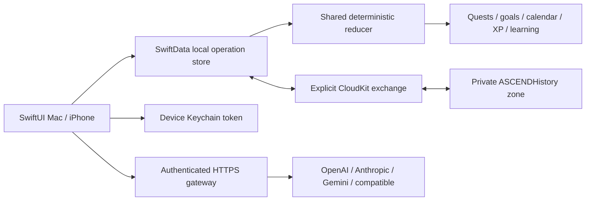

# Architecture and convergence

## Boundaries

`Sources/AscendCore` contains Foundation-only domain models, canonical dates, recurrence, the merge reducer, archive validation, progression, and deterministic grading. `App/AppStore.swift` persists immutable changes in SwiftData. SwiftData automatic CloudKit synchronization is explicitly disabled with `cloudKitDatabase: .none`.

`App/CloudSync.swift` is the sole sync mechanism. `AIClient.swift` handles authenticated gateway transport and Keychain storage; `Reminders.swift` handles system notifications. SwiftUI views consume the same derived ledger on macOS and iPhone. `Gateway` contains provider adapters and service-side security/usage enforcement.

## Source of truth

A `Change` has an immutable UUID, installation actor ID, Lamport clock, history generation, entity kind, stable entity identifier, field patch, tombstone flag, and diagnostic creation date. Its ID identifies transport retries. Its entity ID identifies the logical record. These identities have different jobs.

Each local write uses `max(observed Lamport clocks) + 1`. The wall clock does not decide conflict winners. Local changes are inserted and saved immediately. A persisted `uploaded` marker is the outbox; it survives restarts. Downloaded changes and their CloudKit cursor are committed in one SwiftData save. Failed mutations roll back before exposing the new ledger to the UI.

The reducer indexes operations by kind and entity. XP, ranks, goals, streaks, accuracy, and heatmap values are rebuilt from these records. Device totals are never added together. An operation ID repeated with a different payload is rejected.

## Conflict rules

All replicas sort operations by `(Lamport clock, completion-undo priority, actor ID, operation ID)`. This defines a total order even for simultaneous offline edits. It is deterministic arbitration, not a claim to know the true wall-clock order of concurrent actions.

| Record | Resolution |
| --- | --- |
| Profile, categories, goals, templates | Per-field last-writer-wins registers in the total order. Independent field edits survive. Array-valued fields such as subject selections and milestone definitions are atomic fields. |
| Routine revisions | Immutable, effective-dated field patches, ordered first by effective day and then operation order. Independent future field changes merge. A full quest snapshot validates each patch. Older v1 snapshots without patches remain readable. |
| Dated occurrence snapshots | Atomic first-writer-wins by the same stable total order, freezing the first reconciled plan for that logical occurrence. Explicit occurrence edits are separate override records. |
| Completion / undo | One atomic state per logical occurrence. Later observed actions win; equal-clock undo beats completion. Concurrent actions at different clocks use the total order. Reward and quantity move together. |
| Learning attempts | One atomic answer/feedback state per session + question. A submitted attempt beats any draft. The latest submitted state wins; maximum hint usage and saved reports are retained. |
| Deletion tombstones | Sticky for that entity ID, regardless of later edits. Restoring an archived item changes its archive flag; a tombstoned entity needs a new ID. |
| Shared reset | A reset chooses a new generation. Operations from all previous generations are excluded, including previously unseen changes from an offline device. Reset ties use operation order. |

The same set of valid operations produces the same history regardless of arrival order, repetition, or grouping. Tests exercise commutativity, associativity, idempotence, independent offline edits, completion/undo ties, and stale updates after deletion/reset.

## Quest identity and scheduling

- Daily/weekday occurrence: `templateID|day|YYYY-MM-DD`.
- One-time occurrence: `templateID|once`.
- Explicit weekly session: `templateID|week|MondayDay|session|sessionID`.
- Completion ledger record: exactly the occurrence ID, rather than a new random reward-event ID.
- Learning attempt: `sessionID|questionID`.

Daily and weekly boundaries use a Gregorian calendar in the shared planning timezone. Weeks begin Monday. Calendar arithmetic adds civil days rather than 86,400-second intervals, avoiding DST duplication. Daily occurrences are materialized only through the current planning day, including backfill after the app has been closed. Future days are projections, not prematurely frozen records.

Each template has immutable schedule revisions. Routine edits apply tomorrow; weekly routine changes apply next Monday. Occurrence-only edits change title/details/reward settings for that occurrence without changing its planned status. Once a completion has a reward snapshot, undo/re-completion restores that same reward and goal quantity.

Weekly sessions are explicit records created by the session logging flow. Repeated confirmation of the same draft uses the same session ID. Two different sessions logged offline on different devices both survive. Weekly targets are not counted as planned daily tasks, and sessions beyond the target can still be logged.

Historical denominators use saved occurrence snapshots. An offline device can produce a snapshot without seeing a concurrent schedule revision. After merging, the deterministic first snapshot wins for that logical day; it is never silently rewritten to the latest template. This favors stable recorded history over retroactively inferring an intention neither device could observe.

## Planning timezone changes

The first onboarding profile supplies the baseline timezone; simultaneous independent onboarding is reconciled deterministically. A timezone change is an immutable transition with an effective instant at the next midnight in the old timezone. Before that instant, the old zone determines today. After it, the new zone determines future planning days. Previously materialized day strings and reward assignments are never converted.

Moving west can repeat a civil date; stable occurrence IDs reuse that day instead of duplicating it. Moving east can advance the date; reconciliation backfills canonical dates through the new today. Unmaterialized historical snapshots select the timezone transition effective for that historical planning date. The app reconciles on activation and checks date changes while running; it does not require an iPhone midnight background process.

## Progression and calendar

Quest XP is 10/25/50 for easy/medium/hard. Level L requires `100 + 25 × (L − 1)` XP to advance. Levels start at 1; ranks are E 1–9, D 10–19, C 20–34, B 35–49, A 50–74, and S 75+. Missed days never subtract XP.

Calendar brightness uses completed planned daily occurrences divided by planned daily occurrences. Each completion increases the tile’s fill and halo continuously with this fraction. Undo reverses that change. One-off and weekly sessions never inflate that denominator. A day with only extra activity has a dot and no invented percentage. Rest days have an outline; future dates remain unfilled; today’s date is underlined.

A streak counts each planning date with a completed quest, submitted puzzle or Brainmaxing answer, finished mental math round, positive numeric goal entry, or checked milestone. History is reduced from active records, so undo and deletion can change earlier days. A day with no activity breaks the streak only after a scheduled day ends. Empty rest days are skipped and future dates are excluded. Calendar brightness still shows the fraction of planned quests completed.

Goal totals are active completion quantities plus live manual contributions, or the sum of completed milestone weights. Undo removes the completion’s contribution once. Progress meters clamp visually at 100%, while the numeric value can exceed the target.

Practice grants 5 activity XP per submitted question, including answers awaiting feedback. Assessment grants 10 XP for a correct unhinted answer and 5 with hints; incorrect/ungraded assessed answers grant 0. Rewards are derived from one attempt record, so retries and reopening do not multiply XP. Assessment accuracy is reported separately from practice credit.

## Cloud exchange protocol

The same bundle configuration uses one private container, custom zone `ASCENDHistory`, and record type `AscendOperation`. The record name is the immutable change ID; its `payload` Bytes field contains version-1 JSON. No query index, uniqueness constraint, or server-side total is required.

An exchange checks account availability and bound identity, fetches all zone-change pages, validates the merged graph, saves records plus cursor atomically, reconciles missing local occurrences, and uploads pending changes in batches of 100. Immutable record collisions are acknowledged only if the decoded payloads match exactly. Partial upload failures retain pending work. An expired cursor causes a full refetch, not a data reset.

Account identity is checked again around transfer stages. Sign-out/account-change notifications pause syncing. A different account cannot receive the old account’s local history without a deliberate export/clear/import process. An unexpectedly removed zone or record pauses exchange instead of blindly recreating stale cloud data.

The app observes availability, pending changes, errors, and last completed exchange. “Exchange complete” does not mean another device has downloaded anything. There is no background-push/CKSyncEngine side channel and no automatic SwiftData CloudKit sync. Transfers run on foreground activation, shortly after local edits while open, and when the user retries.

## Versioning and growth

JSON exports have `version: 1`, an export timestamp, and immutable changes. The importer checks size, clocks, scalar types, dates, identities, relationships, routine patches, learning schema, and duplicate-ID collisions before mutating storage. Unknown archive versions fail explicitly. Credentials and per-device metadata are excluded.

This release retains its operation log and tombstones. It does not implement log compaction, multi-account database switching, or multi-tenant gateway hosting. Those require explicit migrations/protocol changes rather than silently discarding history.
