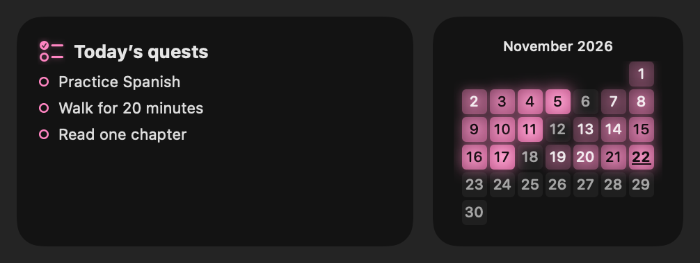

# ASCEND

A native, standalone SwiftUI app for macOS and iPhone. Quests, routines, real goal contributions, a consistency calendar, RPG-style progression, and provider-independent educational practice share one local-first history.

**Run ASCEND from source.** Open `ASCEND.xcodeproj`, select **ASCEND → My Mac**, and click Run. Quests, goals, and the calendar work immediately in local mode.

**Open the packaged Mac app.** In the local project folder, open `Downloads/ASCEND.app`. The portable download is `Downloads/ASCEND-Mac.zip`. Unzip it and drag the app into Applications. The included build is locally signed. For public distribution, sign and notarize a distribution build, then attach the ZIP to a GitHub Release.



## What is implemented

- Native Mac sidebar, resizable windows, ⌘N for a quest, ⇧⌘R for an enabled cloud exchange; native iPhone tabs and navigation.
- Ten themes (Shadow, Amber, Emerald, Crimson, Blue, Baby Blue, Pink, Lilac, Peach, and Teal), shared profile preferences, original vector branding, reduced-motion support, accessibility labels, and an accessible calendar list at large text sizes.
- Mac desktop widgets for unfinished tasks, monthly calendar glow, and level progress. Control-click the desktop, choose **Edit Widgets**, and search for **ASCEND**.
- A 30-day agenda for selected Apple calendars, Google accounts enabled in the system Calendar app, and Canvas LMS calendar subscriptions. [Connection instructions](Docs/SETUP.md#school-and-personal-calendars)
- Confirmed deletion of individual occurrences or whole quests, including archived routines and logged weekly sessions. Archive remains available to preserve earned progress.
- One-time, daily, selected-weekday, and weekly-session quests; individual-occurrence versus future-routine edits; archives; today/upcoming/completed/missed/category filters.
- Immutable dated schedule snapshots, a continuous calendar glow, rest-day outlines, future-day protection, extra-activity markers, date details, planning timezone transitions, and scheduled-day streaks.
- Numeric and weighted-milestone goals, linked quest contributions, editable manual contribution history, exact undo, levels, category XP, and ranks.
- Explicit private CloudKit operation-log synchronization, durable pending changes, stable identities, deterministic field merging, persistent deletion/reset protection, account isolation, and honest exchange status.
- Brainmaxing configuration, generated-session caching, persisted drafts/answers, graduated hints, local numerical/choice grading, online conceptual/proof/code feedback, review topics, reports, and distinct practice/assessment rewards. Generated code is never executed.
- Authenticated Node gateway with separate OpenAI, Anthropic, Gemini, and OpenAI-compatible adapters, request/output limits, provider/model allowlists, bounded retry, cancellation, persisted usage limits, and public-endpoint restrictions.
- Local notifications with a shared delivery-device preference, short onboarding, validated versioned JSON import/export, and explicit local/shared reset flows.

The personal database starts empty at level 1. UI validation uses the explicit `--validation` launch argument and a separate database; no sample progress is installed into personal history.

## Build and test

Inspected environment: Xcode 27.2 (27B52), Swift 6.4.2, macOS/iOS 27.2 SDKs. Deployment targets are **macOS 14+ and iOS 17+**. Swift 5 language mode and stable Apple SDK APIs are used. There are no third-party Swift packages or gateway npm dependencies.

```sh
# Run from this folder.
swift test
(cd Gateway && node --test)

# Standalone, locally signed universal Mac app.
./Scripts/build-local.sh

# iPhone simulator compilation.
xcodebuild -project ASCEND.xcodeproj -scheme ASCEND \
  -configuration Debug -destination 'generic/platform=iOS Simulator' \
  -derivedDataPath build/ios CODE_SIGNING_ALLOWED=NO build
```

The focused domain tests use `Package.swift`; the app target uses the same source files directly. The checked-in Xcode project is ready to open. `python3 Scripts/generate_project.py` regenerates project membership if new Swift files are added, but also rewrites signing/build settings: preserve your team and container changes first.

## Configuration and installation

1. **Mac:** use the included app or build the local scheme. See [Mac and iPhone installation](Docs/SETUP.md).
2. **iPhone:** select your development team and bundle identifier in Xcode, pair your phone, and Run. Physical-device signing is a user setup step.
3. **Shared history:** configure the same private CloudKit container and environment on both platforms, use the **ASCEND-Cloud** scheme, then enable iCloud in Settings. The local scheme intentionally does not pretend to sync.
4. **AI:** configure and run the gateway, enter its HTTPS URL and gateway token in the app, load the server’s model list, and test the provider. API credentials stay on the server. See [gateway setup](Gateway/README.md).

## Documentation

- [Signing, CloudKit, and installation](Docs/SETUP.md)
- [Architecture and conflict rules](Docs/ARCHITECTURE.md)
- [Data export, reset, account changes, and physical deletion](Docs/DATA.md)
- [Actual validation results and remaining checks](Docs/VALIDATION.md)
- [Official API references](Docs/REFERENCES.md)
- [Authenticated AI gateway](Gateway/README.md)

## Practical boundaries

CloudKit account-to-account behavior and live provider calls require your configured signing, Apple Account, and API access. They have **not** been claimed as live-verified in this delivery. Offline tracking and deterministic merge behavior are tested independently.

Cloud exchanges happen when the app becomes active, shortly after local changes while running, and on explicit retry. This is not continuous background synchronization. Reminders are scheduled for up to seven days, within a 60-notification budget; reopen the app to refresh them. Switching the reminder device cannot remotely cancel already-scheduled notifications on an offline old device.

The gateway is a personal, single-instance service. It is not a multi-tenant hosted product. No paid infrastructure was deployed, and the app was not published or notarized. The local Mac build is intended for this machine; distribution requires your signing and release process.

The operation archive is append-only in this release. A shared reset hides the previous generation everywhere and prevents stale resurrection; it is not physical erasure of the underlying archive. See the data guide before deleting CloudKit data or moving between environments.
